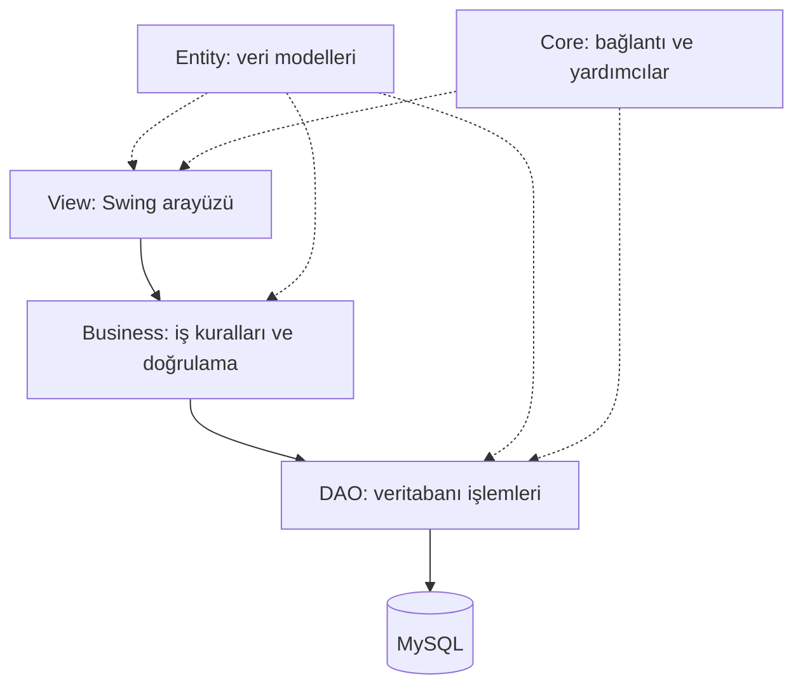
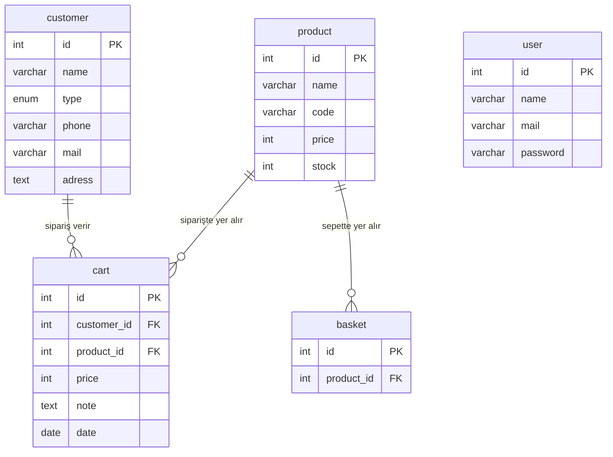

# Müşteri Yönetim Sistemi

[](https://openjdk.org/)
[](https://www.mysql.com/)
[](https://docs.oracle.com/javase/tutorial/uiswing/)
[](LICENSE)

Müşteri, ürün ve sipariş süreçlerini tek bir uygulamadan yönetmeyi sağlayan, Java Swing ve MySQL tabanlı masaüstü CRM uygulaması. Patika.dev Full Stack Java Geliştirici Eğitimi kapsamında geliştirilmiştir.

## İçindekiler

- [Özellikler](#özellikler)
- [Mimari](#mimari)
- [Kurulum](#kurulum)
- [Kullanım](#kullanım)
- [Veritabanı şeması](#veritabanı-şeması)
- [Proje yapısı](#proje-yapısı)
- [Teknolojiler](#teknolojiler)
- [Katkıda bulunma](#katkıda-bulunma)
- [Lisans](#lisans)

## Özellikler

### Kullanıcı

- E-posta ve şifre ile giriş
- E-posta biçimi doğrulaması
- Kullanıcıya özel karşılama ekranı

### Müşteriler

- Müşteri ekleme, güncelleme ve silme
- **Bireysel** ve **Kurumsal** müşteri tipleri
- İsme ve tipe göre filtreleme
- Sağ tık menüsüyle hızlı işlem

### Ürünler

- Ürün ekleme, güncelleme ve silme
- Ürün kodu, fiyat ve stok takibi
- İsme, koda ve stok durumuna göre filtreleme

### Sepet ve siparişler

- Stok kontrolüyle sepete ürün ekleme
- Sepet toplamı ve ürün sayısı gösterimi
- Müşteri seçerek not ve tarihle sipariş oluşturma
- Sipariş geçmişi

### Arayüz

- Nimbus görünümü ve sekmeli kontrol paneli
- Türkçe arayüz

## Mimari

Proje katmanlı mimariye göre düzenlenmiştir:



**Tasarım desenleri:**

- **Singleton:** Veritabanı bağlantısı (`Database.java`)
- **DAO:** Veri erişim katmanı
- **MVC:** Model, görünüm ve denetleyici ayrımı

## Kurulum

### Gereksinimler

| Araç | Sürüm | Açıklama |
| --- | --- | --- |
| Java JDK | 17+ | Derleme ve çalıştırma |
| XAMPP ya da MySQL | MySQL 8.0+ | Veritabanı sunucusu |
| IntelliJ IDEA | 2023.1+ | Arayüz formları IntelliJ GUI Designer ile derlenir |
| MySQL Connector/J | 9.7.0 | JDBC sürücüsü (depoda yoktur, aşağıdan indirilir) |

### 1. Projeyi klonlayın

```bash
git clone https://github.com/yigittozdemirr/java-swing-customer-manage.git
cd java-swing-customer-manage
```

### 2. Veritabanını kurun

XAMPP Control Panel'den **Apache** ve **MySQL** servislerini başlatın. Ardından [phpMyAdmin](http://localhost/phpmyadmin) üzerinden **İçe Aktar** sekmesini açın ve `db/customermanage.sql` dosyasını yükleyin.

Komut satırını tercih ederseniz şu komutu çalıştırın. Bu yöntem için Apache gerekmez.

```bash
mysql -u root < db/customermanage.sql
```

### 3. Bağlantı ayarlarını kontrol edin

Varsayılan XAMPP ayarlarında değişiklik gerekmez. Farklı ayarlar için `src/core/Database.java` dosyasını düzenleyin:

```java
private final String DB_URL = "jdbc:mysql://localhost:3306/customermanage";
private final String DB_USERNAME = "root";
private final String DB_PASSWORD = "";
```

### 4. JDBC sürücüsünü ekleyin

1. [`mysql-connector-j-9.7.0.jar`](https://repo1.maven.org/maven2/com/mysql/mysql-connector-j/9.7.0/mysql-connector-j-9.7.0.jar) dosyasını indirip proje klasörüne koyun.
2. IntelliJ IDEA'da **File → Project Structure → Libraries → +** yolunu izleyerek dosyayı ekleyin.

### 5. Uygulamayı çalıştırın

IntelliJ IDEA'da `src` klasörünü kaynak klasörü olarak işaretleyin, `src/App.java` dosyasını açın ve **Run** düğmesine tıklayın.

## Kullanım

1. Varsayılan hesapla giriş yapın: `admin@patika.dev` / `123123`
2. **Müşteriler** sekmesinden müşterileri yönetin.
3. **Ürünler** sekmesinden ürün kataloğunu yönetin ve sağ tık menüsüyle sepete ürün ekleyin.
4. **Sipariş Oluştur** sekmesinden müşteri seçip siparişi onaylayın.
5. **Siparişler** sekmesinden sipariş geçmişini görüntüleyin.

> **Not:** Bu bir eğitim projesidir. Şifreler veritabanında düz metin olarak saklanır, bu nedenle gerçek verilerle kullanmayın.

## Veritabanı şeması



## Proje yapısı

```text
java-swing-customer-manage/
├── db/
│   └── customermanage.sql      # Şema ve örnek veri
├── src/
│   ├── App.java                # Giriş noktası
│   ├── core/                   # Database, Helper, Item
│   ├── entity/                 # User, Customer, Product, Cart, Basket
│   ├── dao/                    # Veri erişim sınıfları
│   ├── business/               # İş kuralları
│   └── view/                   # Arayüz sınıfları ve .form dosyaları
├── LICENSE
└── README.md
```

## Teknolojiler

| Teknoloji | Kullanım |
| --- | --- |
| Java 17+ | Programlama dili |
| Java Swing ve Nimbus | Masaüstü arayüz |
| IntelliJ GUI Designer | Form tasarımı |
| MySQL 8.0+ | İlişkisel veritabanı |
| JDBC ve Connector/J 9.7.0 | Veritabanı bağlantısı |

## Katkıda bulunma

1. Depoyu fork edin.
2. Yeni bir dal oluşturun: `git checkout -b feature/yeni-ozellik`
3. Değişikliklerinizi commit edin: `git commit -m "feat: yeni özellik"`
4. Dalı gönderin: `git push origin feature/yeni-ozellik`
5. Pull request açın.

## Lisans

Bu proje [MIT Lisansı](LICENSE) ile lisanslanmıştır.
